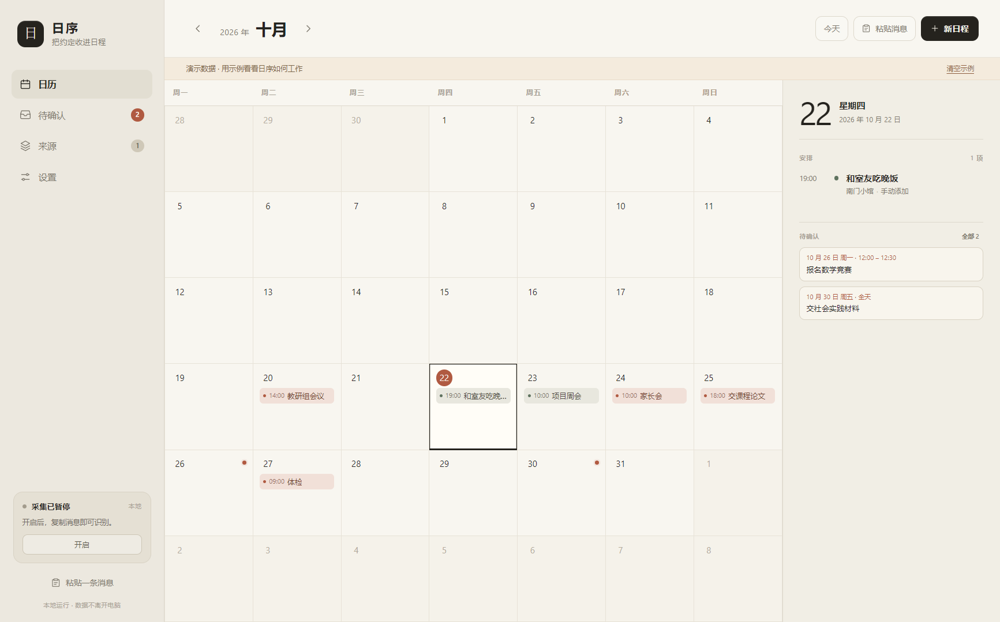
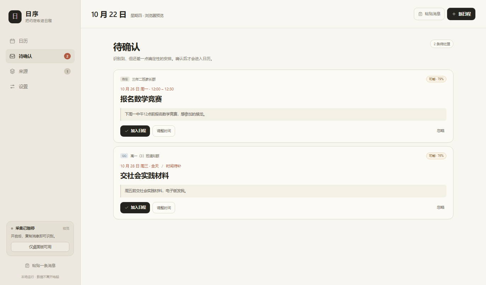
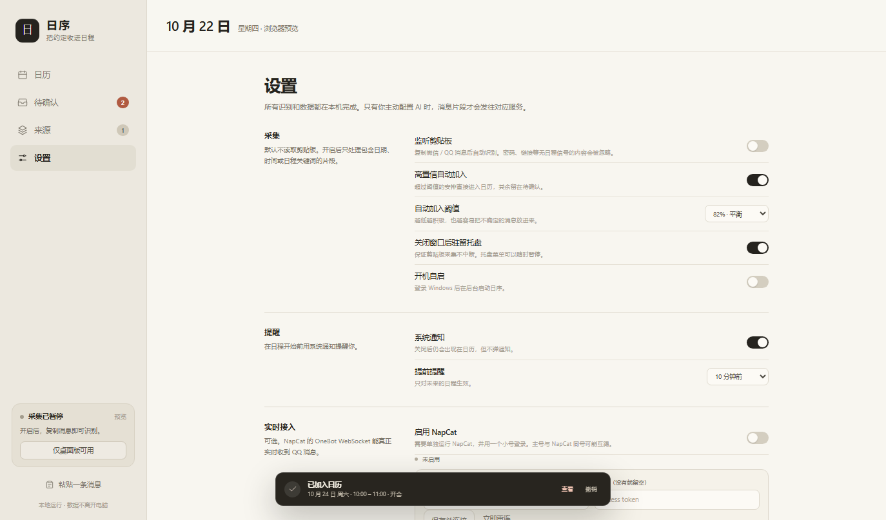

# 日序 · Rixu

把微信 / QQ 聊天里的约定，收进一张极简日历。

复制一条消息，日序自动读懂日期、时间、地点和事件；高置信直接加入日历，其余先放进「待确认」。



## 它能做什么

- **复制即识别**：在微信 / QQ 里复制一条通知，约 1–2 秒后日历里出现新日程。
- **一次复制，一次入历**：识别的是「复制动作」本身（Windows 剪贴板序号），不是剪贴板里的内容。旧消息一直留在剪贴板里不会重复入历；删错了再复制一次就能加回来。
- **AI 优先，本地兜底**：默认先交给 DeepSeek（兼容 OpenAI 接口）理解；没配 Key、调用失败或模型没把握时，自动回退本地中文规则引擎，离线也能用。
- **不污染日历**：日期或时间不确定的安排进入「待确认」，确认后才进日历。
- **来源分级**：重要 / 普通 / 待归类 / 忽略。忽略和待归类的会话不保存正文、不发送给 AI。
- **本地优先**：所有日程数据只存在你自己的电脑上。
- **可选实时接入**：配置 NapCat（OneBot 11）后可直接接收 QQ 群消息，默认关闭。



## 下载即用（Windows，免安装）

不想折腾 Node.js？直接下载最新版：

**[⬇ Rixu-portable.exe](https://github.com/Cumulus-nju/rixu-calendar/releases/latest)**（约 70 MB，单文件，双击即可运行）

首次启动会引导你填自己的 DeepSeek API Key；也可以先跳过，用本地规则识别。

> 这是未签名的 exe，Windows SmartScreen 可能提示「未知发布者」，点「更多信息 → 仍要运行」即可。程序不联网读取你的聊天，数据只存在本机。

## 从源码运行（Windows）

需要 [Node.js](https://nodejs.org/) 18 或更高版本。

```powershell
git clone https://github.com/Cumulus-nju/rixu-calendar.git
cd rixu-calendar
npm install --include=dev
```

然后任选一种方式启动：

- 双击 `启动日序.cmd`（首次运行前必须已完成 `npm install`）
- 或在项目目录执行 `npm start`

macOS / Linux 同样可以运行（`npm install --include=dev` 后 `npm start`），但桌面快捷方式和托盘细节以 Windows 为准。

> `npm install` 会下载 Electron 运行时（约 100 MB）。如果公司 / 校园网很慢，可以先设置 `ELECTRON_MIRROR` 环境变量。

## 配置你自己的 API Key

日序**不内置任何密钥**。要用 AI 识别，需要你自己准备一个 Key（推荐 [DeepSeek 开放平台](https://platform.deepseek.com/)，OpenAI 或其他兼容接口也可以）。

三种填法，任选其一：

1. **首次启动时**：在引导页的「DeepSeek API Key」输入框里粘贴。
2. **设置 → AI 识别**：填 API 地址、模型和 Key，点「测试连接」验证。
3. **环境变量**（适合开发者）：

   ```powershell
   setx DEEPSEEK_API_KEY "sk-你的key"
   ```

   也支持 `RIXU_API_KEY`、`OPENAI_API_KEY`。设置里填的 Key 优先级最高。

Key 只保存在本机数据文件里（`%APPDATA%\rixu-calendar\data.json`），不会进入这个仓库。

不填 Key 也能用：关掉 AI 后完全离线，只走本地规则，覆盖「明天下午三点」「下周三」「10月25日」等常见说法。

## 第一次使用

1. 首次启动勾选「开启剪贴板自动采集」，点「开始使用」。
2. 在微信 / QQ 里选中一条消息，右键复制或 `Ctrl+C`。
3. 日历里出现新日程，或「待确认」出现一条候选。

左下角的采集卡片显示当前状态。关闭窗口会驻留托盘，采集不会中断；从托盘菜单可以暂停或退出。也可以点「粘贴消息」手动导入。

### 删除之后想加回来

- 删掉日程后，即使那条消息还躺在剪贴板里，也不会自己加回来。
- 想加回来：把那条消息**再复制一次**即可。
- 同一段文字重复复制不会产生两条相同日程（按开始时间 + 标题去重）。

日序在 Windows 上通过系统「剪贴板序号」识别复制动作，所以复制同一段文字也算一次新的复制；macOS / Linux 上会退回内容比对，重复复制同一段文字可能不会触发，可以用「粘贴消息」手动导入。



## 能识别什么

**日期**：今天 / 明天 / 后天 / 大后天 / 三天后 / 本周五 / 下周三 / 10月25日 / 25号

**时间**：10点 / 下午3点半 / 14:30 / 10点到11点 / 晚上7点

**事件**：开会 / 会议 / 家长会 / 考试 / 交作业 / 报名 / 截止 / 体检 / 讲座 / 面试 / 聚餐等

**地点**：三楼会议室 / 图书馆报告厅 / 校医院 / 线上

也能处理多行微信、QQ 聊天记录里的群名、发送人和消息正文，以及「主题 + 时间 + 地点 + 主讲人」格式的通知 / 海报：

```text
深刻理解习近平党建思想的精髓要义
地点:苏教A108教室
时间:2026年10月23日上午11:00-12:00
主讲人:姚润皋
```

会生成：标题、2026-10-23 11:00–12:00、苏教A108教室，并把主讲人写进备注。

## 数据与隐私

- 所有数据在本机，默认路径：`%APPDATA%\rixu-calendar\data.json`（macOS/Linux 用 Electron 的默认 userData 目录）。
- 设置 → 数据可以导出 / 导入 JSON，或打开数据文件夹。
- 不注入微信 / QQ 进程，不解密本地聊天数据库，不读取未复制的内容。
- 剪贴板监听只处理包含日期、时间或日程关键词的片段；密码、链接等会被过滤。
- AI 开启时，「重要 / 普通」来源的消息片段会发往**你所配置的** AI 服务；忽略和待归类的群不会上传。关掉 AI 即完全离线。
- NapCat 是可选通道，默认关闭。

## NapCat 实时接入（可选）

设置 → 实时接入，填写 NapCat 的 OneBot 11 正向 WebSocket 地址，例如 `ws://127.0.0.1:3001`。

重要限制：

- NapCat 是**一次真实 QQ 登录**，不是一个免登录旁路。
- 用主号登录 NapCat，可能和官方 PC QQ 互踢，并有账号风控风险。
- 推荐用一个小号登录 NapCat，把小号拉进需要的群；只能看到小号所在群的实时消息。
- 离线期间的消息不会自动补全，历史记录需要单独调接口。
- 新群默认「待归类」，不会自动识别，需要你到来源页标记。

## 项目结构

```text
main.js                    Electron 主进程：窗口、托盘、剪贴板、NapCat、AI 代理、文件
preload.js                 安全 IPC 桥
src/index.html             页面骨架
src/styles.css             极简视觉
src/app.js                 日历、来源、待确认、设置、采集管线
src/parser.js              本地中文日程解析器（无依赖）
test/parser.test.js        解析器单元测试
tools/create-shortcut.ps1  重建桌面快捷方式
tools/mock-ai.js           本地 mock AI 服务（开发用）
tools/mock-onebot.js       本地 mock OneBot 服务（开发用）
```

开发命令：

```bash
npm install --include=dev
npm test          # 解析器单元测试
npm start         # 启动应用
npm run screenshot  # 无头截图
npm run dist        # 打包 Windows 免安装 exe 到 release/
```

> 如果你的环境设置了 `NODE_ENV=production`，安装时务必带 `--include=dev`，否则 Electron 不会装上。

## 已知限制

- 微信 / QQ 本地数据库是加密的，直接读库需要注入或取密钥，本项目不做。
- 剪贴板通道需要你主动复制消息，不能读取未复制的聊天。
- NapCat 的能力取决于登录账号和 OneBot 配置；应用层只做第二层筛选。
- 解析器是本地规则引擎；AI 默认作为首选识别层，失败时自动回退。
- macOS / Linux 没有剪贴板序号，复制同一段文字不会再次触发识别；Windows 不受影响。
- 目前只提供源码运行方式，尚未提供打包好的安装包（欢迎 PR）。

## 贡献

Issue 和 PR 都欢迎。提交代码前请跑一遍 `npm test`。

## License

[MIT](LICENSE)
